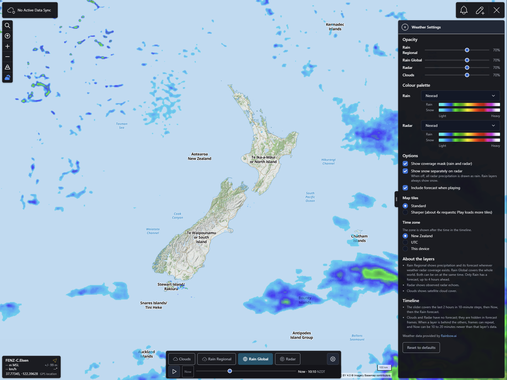
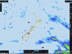

# Weather

CloudTAK plugin that adds rain, radar and cloud layers to the map, with a timeline from 2 hours ago to a 4 hour rain forecast.

Weather data provided by [Rainbow.ai](https://rainbow.ai).

## What it does

* A weather button (tooltip **Weather Controls**) sits in the map's left controls, under the 3D terrain button. Click it to open the weather panel at the bottom of the map; click it again, or press Escape, to close it. Closing the panel leaves the layers on, and a dot on the button shows that a layer is on while the panel is closed. All layers are off by default, so nothing is requested until you turn one on.
* The top row of the panel has four independent layer toggles: **Clouds**, **Rain Regional**, **Rain Global** and **Radar**, and the settings gear (**Weather Settings**) at the right end. Any combination can be on; they stack in that order, bottom to top (Clouds, Rain Global, Rain Regional, Radar). The bottom row has **Play**, **Now**, the time slider and the time of the frame with its time zone (for example `-40 min · 13:40 NZDT`, `Now · 01:20 UTC`). A warning icon appears next to the time when the weather service has a problem.
* The **time slider** covers the last 2 hours in 10 minute steps, a small mark at **Now**, and, while either Rain layer is on, the rain forecast up to 4 hours ahead. The arrow keys move one step. Clouds and Radar have no forecast, so they are hidden in forecast frames (their toggles are dimmed with the tooltip **No forecast**, and clicking them still works). The map always opens, and closes, at Now.
* **Play** steps through the last 2 hours at one frame every 0.7 seconds, from -120 min to Now, holds on Now for a moment and starts again. Press it again to pause. It needs at least one layer on. With **Include forecast when playing** (on by default) and a Rain layer on, Play also runs through the forecast up to +4 hours. It waits for the tiles of the next frame (at most 3 seconds), so a slow connection slows the loop instead of showing blank frames.
* Play pauses when you drag the slider, press Now, move, zoom or rotate the map, close the panel or switch the plugin off. If the server says it is rate limited, Play pauses with the warning icon and carries on by itself after at most a minute, or when you press Play.
* The first Play pass loads and paces every visible tile of every layer that is on, so with several layers on it can take minutes. The second pass runs from the browser cache at full speed. **Sharper** tiles need about four times as many requests.
* The **Weather Settings** menu entry (right-side menu, or the gear in the panel) has per-layer opacity, a colour palette for both Rain layers and one for Radar (Nexrad by default), a coverage mask, **Show snow separately on radar**, map tile sharpness, whether Play includes the forecast, and the time zone for labels (New Zealand, UTC or this device). It also explains the layers and the timeline. Settings are stored in the browser.
* **Other plugins.** When another plugin opens its own panel at the bottom of the map (for example Rubber Sheet), the weather panel closes. The layers stay on and it does not reopen by itself. The plugins tell each other through the `cloudtak-plugin:panel-open` and `cloudtak-plugin:panel-close` events on `window`; the contract is described in [`docs/fork/PLUGIN-PANELS.md`](https://github.com/TAK-NZ/CloudTAK/blob/main/docs/fork/PLUGIN-PANELS.md) of the TAK-NZ CloudTAK fork, and the shared helper is `lib/panel-coordinator.ts` (MIT-0).
* The map shows "Weather © Rainbow.ai" as source attribution while a weather layer is on. The settings page links to Rainbow.ai.

More detail: [docs/behaviour.md](docs/behaviour.md).

## Screenshots

The weather panel at the bottom of the map with Rain Global on, and the Weather Settings window on the right with the opacity sliders, the colour palettes with their legends, the options and the time zone.



Play steps through the frames and loops.



## Requirements

CloudTAK **13.102** or newer, because the weather panel uses the bottom bar plugin API that first appeared in 13.102.0.

A CloudTAK server that provides `/api/weather/status` and `/api/weather/tile/{z}/{x}/{y}.png`, which is the [TAK-NZ CloudTAK fork](https://github.com/TAK-NZ/CloudTAK). If the endpoint is missing or switched off, the plugin adds nothing to the app. A status with a per-layer `latest` lets the timeline line up with each layer's newest data; with an older relay the plugin uses the status snapshot and still works.

The server holds the weather service key and relays the tiles. Set these environment variables on the CloudTAK API task:

| Variable | Meaning |
|---|---|
| `WEATHER_PROXY_URL` | HTTPS base URL of the weather proxy, without a trailing `/{z}/{x}/{y}.png` |
| `WEATHER_PROXY_KEY` | Dedicated weather proxy client key. It never reaches the browser |
| `WEATHER_RATE_LIMIT` | Optional. Tile requests per user per minute, 60 to 6000, default 900 |

The relay also caps upstream fetches at 500 a minute per API task (below the 600 a minute the weather proxy allows per client IP). When the proxy answers 429, the relay stops asking it for 5 to 120 seconds (the proxy's `Retry-After`, default 30) and answers uncached tiles with 429 meanwhile. Cached tiles are still served.

## Security notes
* Tile requests are loaded by MapLibre, which cannot send an `Authorization` header, so every tile URL carries the signed-in user's session token as `?token=`. The weather key and proxy URL stay on the server.
* The CloudTAK platform access log (morgan `combined`, which skips only 2xx and 3xx responses) records the full URL of error responses. Other CloudTAK tile routes use the same `?token=` pattern. The TAK-NZ relay replaces the token in the URL it exposes to that log, but on a server without that change, or behind a proxy that logs URLs itself, a 401, 403, 429 or 502 tile response can write a valid session token to a log.
* The token is a session token, so it expires with the session. Keep sessions short and restrict who can read access logs. A tile loader that sends an `Authorization` header would remove the exposure.
* The plugin never writes the token to the browser console. A failure to read it is reported as `Could not read the session token`; a request the plugin cannot build is reported as `Invalid weather request`, with the error class and no token.

## Install

The plugin is compiled into the CloudTAK web bundle when the CloudTAK image is built. List its URL in the `webPlugins` setting of the CDK context (several plugins can be separated by commas or spaces):

```json
"webPlugins": "https://github.com/TAK-NZ/cloudtak-plugin-weather.git"
```

The build clones the default branch (`main`) with `--depth 1`. A change to this repository alone does not change the image hash, so re-run the image build with `force_rebuild` or change a file under `api/` or `app/`. Users then choose **Settings → Refresh App**, because the service worker caches the old app.

## Development

Put a clone at `app/plugins/cloudtak-plugin-weather` inside a CloudTAK checkout (the folder is git-ignored by CloudTAK). The app's own ESLint, `vue-tsc` and Vitest configuration apply:

```bash
npm run test    # Vitest, plugin specs only
npm run lint
npm run check   # vue-tsc for the whole app
```

The same checks run as part of `npm run lint && npm run check && npm run build` in `app/`.

## Licence

GNU Affero General Public License v3.0 only. See [LICENSE](LICENSE). The menu icon is Font Awesome Free (CC BY 4.0); see [NOTICE](NOTICE).
